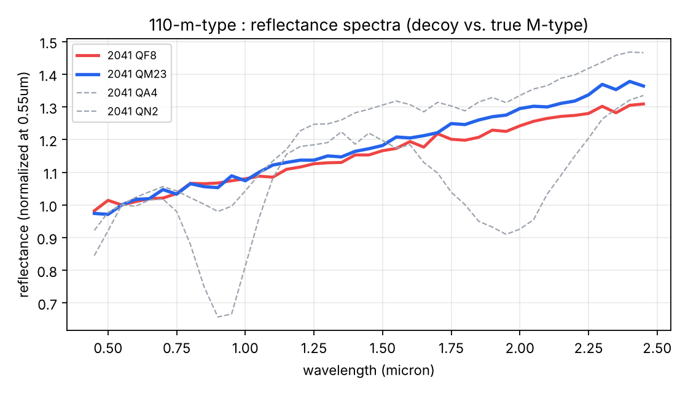

# 110 · m-type

> **Category:** Astro / Spectroscopy / Data · **Points:** 100 · **Track:** [Asteroid missions](README.md)

## Challenge

Among fourteen freshly discovered asteroids, only one is a metal-rich body carrying platinum-group metals, worth a prospecting trip. The desk's prospecting lead (Kaito) already has his pick:

> Metal is shiny. Sort by albedo, take the brightest flat spectrum, done. QF8 is flat and it practically glows.

His colleague Sunniva warns: *"Shiny is not the same as metal, read the whole sheet."*

## Why QF8 is a decoy

`2041 QF8` does have a flat spectrum and a very high visual albedo (`pV = 0.52`). But the radar log notes that its "strongest echo of the night" coincides with its **closest approach** of the night (0.011 AU). Radar-echo strength scales as the inverse fourth power of distance, so a small, nearby body will always produce a huge echo regardless of composition. Kaito is mistaking a distance artefact for a composition signature.

## Identifying the right candidate

A quantitative pass over the 14 spectra (`spectra.csv`, 0.45–2.45 µm): compute the depth of the ~1 µm absorption band (the olivine/pyroxene signature typical of S-types) relative to the local continuum, and cross-reference with the visual albedo (`survey_night.csv`):

```python
cont  = (y[idx(0.70)] + y[idx(1.30)]) / 2
depth = (cont - y[idx(0.95)]) / cont
```

| Designation | 1 µm band depth | Visual albedo pV | Radar albedo |
|---|---|---|---|
| 2041 QF8 | 0.1 % (flat) | 0.520 (very high) | Strong, but explained by distance |
| **2041 QM23** | **0.9 % (near-flat)** | **0.180 (moderate, typical of M-type)** | **0.41, abnormally high once normalized for size** |

`2041 QM23` combines all three signatures expected of an M-type:

1. a featureless spectrum with no silicate absorption band
2. a moderate visual albedo (neither as dark as a C-type nor as bright as QF8)
3. a high radar albedo once corrected for size

Metallicity shows up in radar, not to the eye, exactly as Sunniva points out.



*Normalized spectra: QF8 (decoy, red) vs. QM23 (chosen candidate, blue). Both are flat, and only the radar albedo tells them apart.*

## Sizing the body

Using the absolute magnitude `H = 22.1` and the visual albedo `pV = 0.180` (the thermal-IR source, the only one available for all 14 bodies and therefore the mandated reference for sizing):

```
D (km) = 1329 / sqrt(pV) * 10^(-H/5)
       = 1329 / sqrt(0.180) * 10^(-22.1/5)
       ≈ 0.119 km  →  119 m  →  120 m  (rounded to the nearest 10)
```

The same object is recovered by orbit determination in [Short Arc](short-arc.md).

## Flag

```
GAIANSPACE{2041QM23_120}
```

---
[← Back to index](../../README.md)
