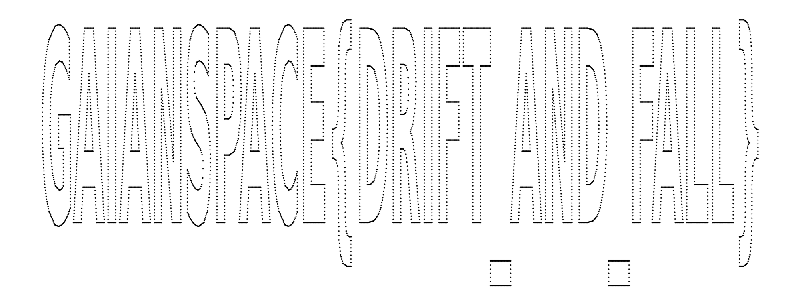

# 307 · descent-diary

> **Category:** Forensics / Data · **Points:** 141 · **Track:** [Foundation One](README.md)

## Challenge

The full descent diary of a CanSat (`descent_log.csv`) contains, besides the barometer/altimeter, a 3-axis accelerometer and a magnetometer with **only 2 axes** (`mag_x_uT`, `mag_y_uT`). The brief insists:

> The barometer tells a tidy story, a clean fall up to a hard stop in the dirt, and that's not where the surprise is. The CanSat carried more than one instrument, and one of them was not watching the sky at all. Let that instrument draw its own picture and it stops looking like noise.

## Approach

The magnetometer is the instrument that is "not watching the sky". It is irrelevant to measuring a vertical fall, which makes it the one the prompt points to. The key is to plot it as an **X/Y scatter** (`mag_x_uT` on the x-axis against `mag_y_uT` on the y-axis, with no connecting line), **not** as a time series and not through a spectrogram or FFT:

```python
mx, my = channels["mag_x_uT"], channels["mag_y_uT"]
plt.scatter(mx, my, s=0.3, color="black")
plt.axis("off")
```

The scatter plot literally draws text: the sensor was effectively driven as an X/Y plotter (Etch-A-Sketch style), each timestep placing the "pen" at the `(mag_x, mag_y)` position that corresponds to part of a letter.



*`mag_x` vs `mag_y`: the text appears directly, with word gaps rendered as small squares standing in for underscores.*

The plotted message reads `GAIANSPACE{DRIFT AND FALL _ _}`. The two isolated squares correspond to the gaps between words and read as underscores once the flag is assembled.

## Flag

```
GAIANSPACE{DRIFT_AND_FALL}
```

---
[← Back to index](../../README.md)
