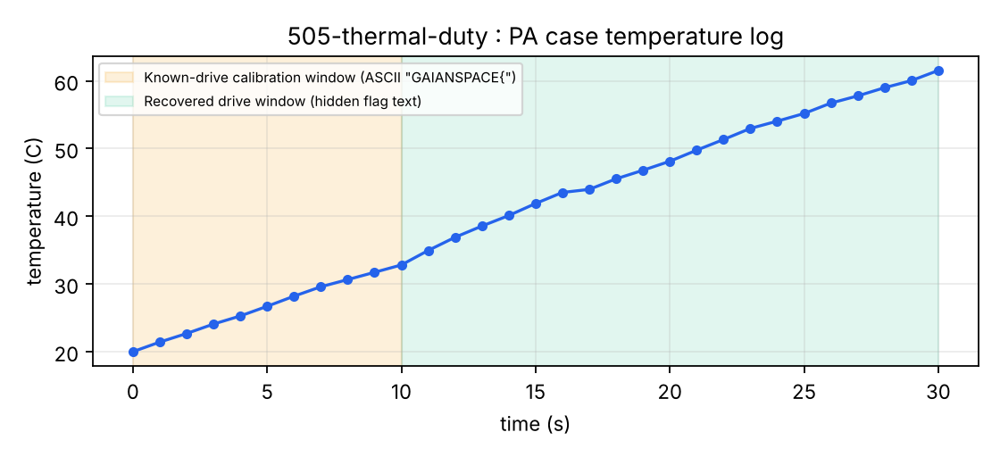

# 505 · thermal-duty

> **Category:** Data / Hardware · **Points:** 75 · **Track:** [Foundation One](README.md)

## Challenge

The flight log of an onboard radio (the Foundation One PA case) gives a thermal model of the amplifier module, but the bench-fit sheet (`K`, `tau`, `Tamb`) is reported "missing". The supplied model is:

```
T[n+1] = T[n] + dt * ( K * P[n] - (T[n] - Tamb) / tau )
```

`P[n]` is the amplifier's drive count. It was never logged, and it is exactly the quantity to recover at every time step. The hint title is *"Counts, then characters"*.

## Key insight

The team's note states that *"the model is linear in all three parameters, and the team has always re-fitted them from any stretch where the drive is already known."*

The mandated flag format (`GAIANSPACE{...}`) conveniently supplies a **known plaintext prefix** in advance: the first 11 characters of the drive time series are simply the ASCII codes of `GAIANSPACE{`. That gives a free calibration window.

## Solution

### 1. Calibrate on the known prefix

Recast the recurrence as a linear system in three unknowns (`K`, `a = 1/tau`, `b = Tamb/tau`) over the first steps, using `P[n] = ord(prefix[n])`:

```python
import numpy as np

T = [...]                 # temp_c column from the CSV
dt = 1.0
prefix = "GAIANSPACE{"
known_P = [ord(c) for c in prefix]

A, y = [], []
for n in range(len(known_P)):
    dT = T[n + 1] - T[n]
    A.append([dt * known_P[n], -dt * T[n], dt])
    y.append(dT)

K, a, b = np.linalg.lstsq(np.array(A), np.array(y), rcond=None)[0]
tau, Tamb = 1 / a, b / a
```

Result: **K = 0.0200, tau = 40.00 s, Tamb = 20.00 °C**, with a calibration residual on the order of 7·10⁻⁷. That is essentially zero, which confirms that the prefix hypothesis is correct.

### 2. Invert the model

The model is then inverted over the rest of the series to extract the un-logged `P[n]` values:

```python
for n in range(len(known_P), N - 1):
    dT = T[n + 1] - T[n]
    P = (dT / dt + a * T[n] - b) / K
    # round(P) -> ASCII code of the next character
```

The recovered values

```
[116, 104, 101, 114, 109, 52, 108, 95, 100, 117, 116, 121, 95, 99, 121, 99, 108, 101, 125]
```

read directly as the ASCII string `therm4l_duty_cycle}`.



*Temperature curve. Orange zone: calibration window (known prefix). Green zone: inverted window used to recover the hidden drive signal.*

## Flag

```
GAIANSPACE{therm4l_duty_cycle}
```

---
[← Back to index](../../README.md)
