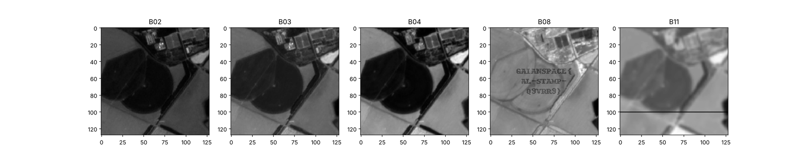
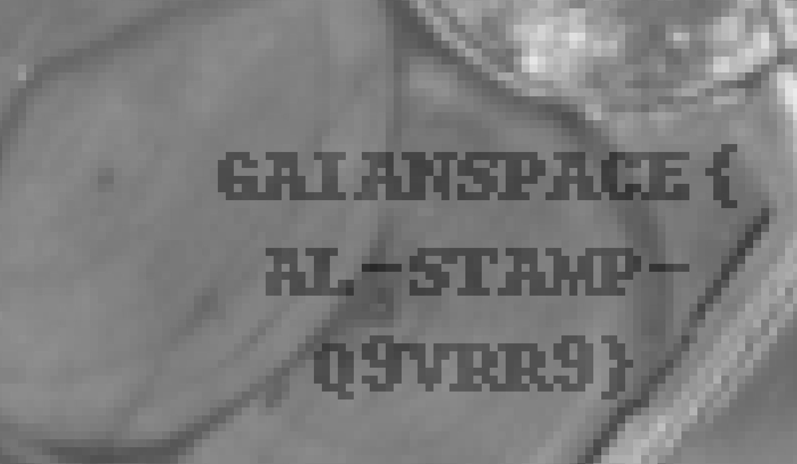

# 121 · channel-hop

> **Category:** Remote sensing / LoRa / Forensics · **Points:** 200 · **Track:** [Space comms](README.md)

## Challenge

An agricultural LoRa field mast (AgriLink) receives a satellite tile every clear morning (5 Sentinel-2 channels: `B02`, `B03`, `B04`, `B08`, `B11`), relayed packet by packet. The tractor rejects the map with *"map integrity: unverified"*, and the farmer can never find the "delivery stamp" AgriLink promises in the bottom-left corner of the true-colour tile view.

## Approach

### Reconstructing the protocol

The radio journal `mast_rx_0540.log` gives the hex payload of every received frame. Decoding the header reveals a metadata frame (type `'M'`):

```
tile=0704 site=BABB-N date=2025-07-04 src=S2 L2A gsd=10m px=128x128
ch=B02,B03,B04,B08,B11 scale=refl*400
```

It is followed by **640 data frames** (type `'D'`), each carrying a channel byte, a row byte and 128 pixel bytes. That is exactly 5 channels × 128 rows. Reassembling each channel into a 128×128 image:

```python
import numpy as np

channels = {i: np.zeros((128, 128), np.uint8) for i in range(5)}
for b in records:
    if b[5] == 0x44:                      # type 'D'
        ch, row = b[6], b[7]
        channels[ch][row, :] = b[8:8 + 128]
```

### The find

The true-colour composite (`B04`, `B03`, `B02`) shows no visible stamp whatsoever, matching the farmer's complaint. The near-infrared channel **`B08`**, absent from the true-colour render and therefore never visually checked by the tablet app, carries a plain-text watermark that is invisible unless that channel is inspected on its own.



*The five reconstructed channels. The watermark only appears in B08 (near infrared).*



*Close-up of the watermark in the B08 channel.*

## Flag

```
GAIANSPACE{AL-STAMP-Q9VRR9}
```

---
[← Back to index](../../README.md)
